<div align="center">



<br/>

[](https://github.com/Im-new-code/Optium/actions/workflows/optium-build.yml)
[](#-compatibility)
[](#-compatibility)
[](#-compatibility)
[](LICENSE)
[](#-status)

**A compatibility-focused bridge for using a separately obtained OptiFine JAR with Fabric.**

Built around Minecraft **1.17.1**, with special attention to **PojavLauncher, Android and constrained-memory devices**.

[**Get the latest build**](https://github.com/Im-new-code/Optium/actions/workflows/optium-build.yml) · [Report a bug](https://github.com/Im-new-code/Optium/issues/new) · [Performance notes](docs/PERFORMANCE.md)

</div>

---

## ✦ What is Optium?

Optium is an independent Fabric-side compatibility bridge based on the MPL-2.0-licensed [OptiFabric](https://github.com/Chocohead/OptiFabric) implementation. It adapts the bridge for current project targets while keeping OptiFine as a **separate, user-supplied JAR**.

The goal is straightforward: make the OptiFine bridge work reliably in a carefully controlled Fabric setup, including Android launches, without pretending that every mod combination is already compatible.

## ⚡ Highlights

<table>
  <tr>
    <td width="50%">
      <h3>🔌 Fabric ↔ OptiFine</h3>
      Bridge integration for a separately installed OptiFine JAR.
    </td>
    <td width="50%">
      <h3>📱 Android-minded</h3>
      Development and testing focus includes PojavLauncher and low-memory devices.
    </td>
  </tr>
  <tr>
    <td width="50%">
      <h3>🧭 Renderer isolation</h3>
      Detects Sodium/Iris and bypasses the OptiFine bridge so competing renderer pipelines are not deliberately combined.
    </td>
    <td width="50%">
      <h3>🧪 Verifiable builds</h3>
      CI checks project resources, builds with Java 17 and validates the packaged JAR.
    </td>
  </tr>
</table>

> [!IMPORTANT]
> **Optium is experimental.** A successful CI build proves that the mod builds and passes packaging checks, not that Minecraft will launch with every OptiFine, Fabric API or third-party mod combination. ReplayMod keyboard compatibility with OptiFine is an area that requires specific runtime verification.

## 🧩 Compatibility

| Component | Current target | Notes |
|---|---|---|
| Minecraft Java Edition | **1.17.1** | Primary target for the Android profile |
| Fabric Loader | **0.16.14** | Current PojavLauncher target; older compatibility paths remain in the source |
| Java | **17** | Used by the current Android profile and CI build |
| Fabric API | **1.17.x** | Use a build intended for Minecraft 1.17.1 |
| OptiFine | **HD U H2 pre1** for the target profile | Obtain separately; Optium does not bundle it |
| Launcher / device | **PojavLauncher · Android · ARM64** | Device-specific graphics and memory limits still apply |
| Sodium / Iris | **Separate renderer profile** | If detected, Optium intentionally bypasses its OptiFine bridge |
| OptiFabric | **Do not install beside Optium** | Both provide the same kind of bridge |

OptiFine's rendering pipeline is not interchangeable with Sodium/Iris. When Sodium or Iris is detected, Optium skips OptiFine discovery, class replacement and OptiFine-specific mixins. OptiFine features and shaderpacks are therefore **not active in that mode**. Use separate profiles instead of combining both renderers.

## 🚀 Installation

### 1. Get Optium

Open the [**Build Optium workflow**](https://github.com/Im-new-code/Optium/actions/workflows/optium-build.yml), choose a successful run for the branch you intend to test, and download **`optium-mod-jar`** under *Artifacts*. Extract the ZIP to get the distributable `.jar`.

> Workflow artifacts expire after their retention period. They are development builds, not permanent releases.

### 2. Add the required files

For the Minecraft 1.17.1 target profile, place the following in that profile's `mods` folder:

- **Optium** — the distributable JAR from the workflow artifact.
- **Fabric API** — a version made for Minecraft 1.17.1.
- **OptiFine** — separately obtained and compatible with Minecraft 1.17.1.

Do **not** install OptiFabric in the same profile. Keep a backup or duplicate profile before testing, especially on Android.

### 3. Launch and verify

Start the Fabric 1.17.1 profile. If it crashes, attach the first meaningful exception and the end of `latest.log` to an [issue](https://github.com/Im-new-code/Optium/issues). A launcher exit code or screenshot by itself is usually not enough to identify a mixin failure.

## 🛠️ Build and verification

The repository's GitHub Actions workflow runs the resource/metadata checks, builds with Java 17, checks the packaged distributable JAR, and uploads the artifact. The current workflow is the authoritative place to obtain a test build.

To build locally with the wrapper:

```bash
./gradlew --no-daemon build
```

The CI checks cover build and package integrity. They do not emulate the target Android GPU, PojavLauncher or the full installed mod list, so runtime testing remains necessary.

## 📈 Performance work

Optium retains the patched OptiFine class cache to avoid repeating expensive extraction/remapping work on each launch. The project avoids aggressive background activity and unverified memory tweaks in an effort to keep constrained devices stable.

Performance improvements are not claimed without controlled measurements. Compare the same world, scene, resolution, render distance, resource packs and shader state before attributing a change to Optium.

See **[docs/PERFORMANCE.md](docs/PERFORMANCE.md)** for log analysis, a Minecraft 1.17.1 performance-mod matrix and a suggested one-at-a-time test order.

## 🧯 Troubleshooting

- **Crash during mixin application:** save the full `latest.log` and look for the first `MixinApplyError` or `InvalidInjectionException`.
- **Sodium/Iris installed:** expected Optium behavior is to skip OptiFine's bridge. Remove them only in a separate test profile if you want to test OptiFine.
- **Shaderpack not loading:** first verify that the OptiFine bridge is active and that the profile is not in the Sodium/Iris bypass mode.
- **Slow first launch:** allow cache generation to finish once, then compare subsequent warm-cache launches separately.
- **Need deeper diagnostics:** launch with `-Doptium.extract=true` when requested for class-extraction investigation.

## 📚 Project notes

- **Upstream Loader 0.12 support:** [commit](https://github.com/Chocohead/OptiFabric/commit/fc09c5188fd7b8968976df07e7286dcb0ab0c97e)
- **Upstream Fabric API 0.43 fix:** [commit](https://github.com/Chocohead/OptiFabric/commit/48e35b149d9ed23e3f846344ab35a2623ad5b031)
- **Upstream Fabric API 0.43.1+ fix:** [commit](https://github.com/Chocohead/OptiFabric/commit/9d6024e676a67518a8ed7f839360702017daaa57)
- **Performance guide:** [docs/PERFORMANCE.md](docs/PERFORMANCE.md)

## 📜 Attribution & license

Optium modifies source from [Chocohead/OptiFabric](https://github.com/Chocohead/OptiFabric), originally by Modmuss50 and Chocohead. Inherited source remains under the **Mozilla Public License 2.0**. See [LICENSE](LICENSE) for the license and attribution notices.

OptiFine is a separate product and is not distributed with Optium.

---

<div align="center">

**Made for careful testing, compatibility work and better-informed Minecraft setups.**

[](https://github.com/Im-new-code/Optium/stargazers)
[](https://github.com/Im-new-code/Optium/issues)
[](https://github.com/Im-new-code/Optium/commits/main)

<sub>Optium is community-developed and is not an official OptiFine product.</sub>

</div>
